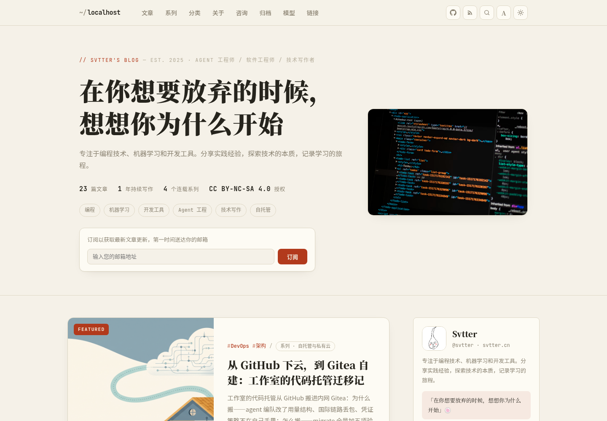
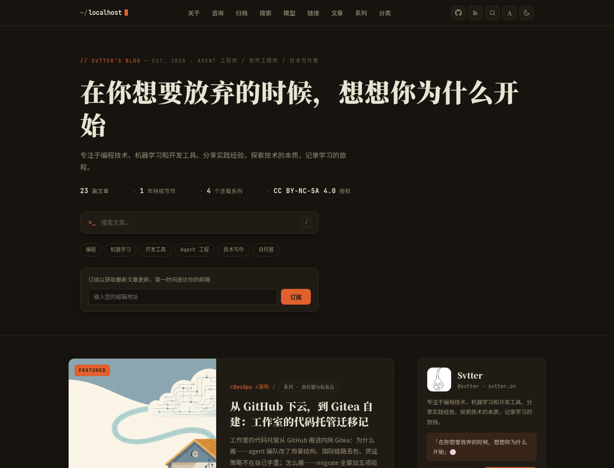
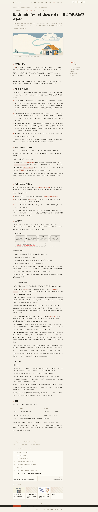
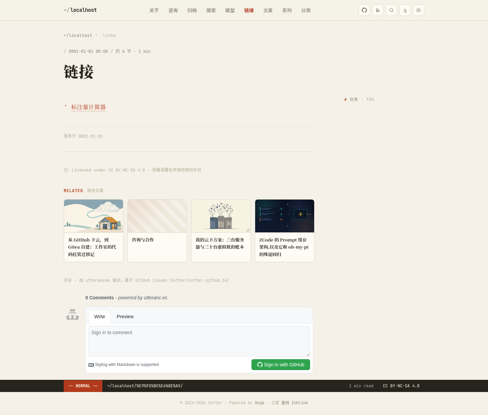
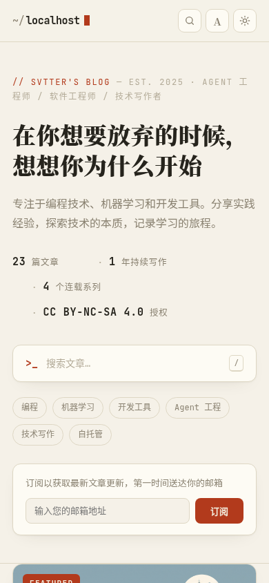
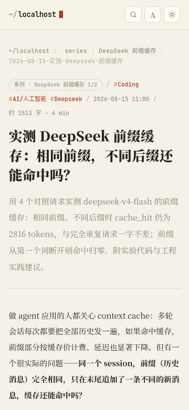
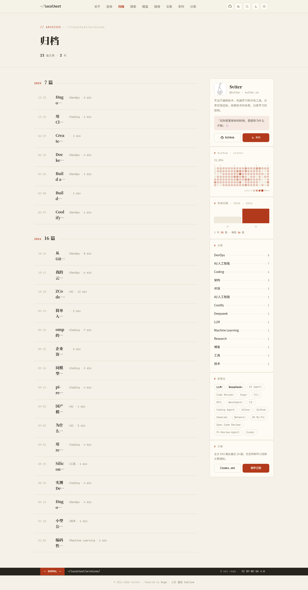
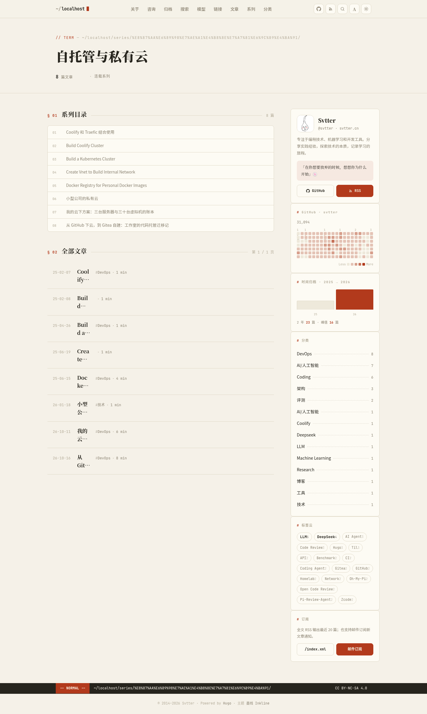

[简体中文](README.md) | **English**

# Inkline 墨线

A Hugo blog theme that blends terminal engineering aesthetics with Chinese editorial typography. Designed for [svtter.cn](https://svtter.cn), and a good fit for any personal blog built around long-form writing.



| Dark home | Article | Related posts & comments |
|---|---|---|
|  |  |  |

| Mobile home | Mobile article | Archives | Series |
|---|---|---|---|
|  |  |  |  |

## Features

**Dual-typeface system** — serif (Noto Serif SC) carries titles and body text, monospace (JetBrains Mono) carries all metadata (dates, indexes, categories, stats). Engineering and editorial voices, layered.

- Light/dark themes: follow the system, manual toggle, persisted
- **Three global font sizes** (small / medium / large): rem root scaling, site-wide proportional typography, persisted
- **Client-side full-text search**: press `/` or `⌘K`; built on the home page JSON output, no backend required
- **Post series**: series cards on the home page, episode list on articles (current post highlighted, N / M progress), previous / next
- **Related posts** (Hugo Related) + utterances comment slot
- Archives page: grouped by year + annual contribution bars in the sidebar
- **GitHub contribution calendar** sidebar card (jogruber API + self-rendered heatmap in theme accent colors, no third-party libraries)
- Carbon Ads slot (renders only when configured; zero output otherwise)
- Shortcodes: `article-card` / `repo-card` (live GitHub data card, follows theme color scheme) / `social-card` / `wechat-card` / `pdf`
- Multilingual UI strings (`i18n/zh-cn.toml` + `i18n/en.toml`)
- Responsive: from 390px up to desktop with zero horizontal overflow (verified by an automated visual audit across 84 page × viewport × theme combinations)
- Vim-statusline footer

## Requirements

- Hugo **≥ 0.120** (uses `.Fragments`, Related, etc.)

## Installation

```bash
# Option 1: Git submodule
git submodule add https://github.com/Svtter/hugo-theme-inkline.git themes/hugo-theme-inkline
# Set theme = "hugo-theme-inkline" in your site config

# Option 2: Hugo Modules
# [module]
#   [[module.imports]]
#     path = "github.com/Svtter/hugo-theme-inkline"
```

## Site parameters (params)

```toml
description = "Programming, machine learning and developer tooling."
motto = "Record, then understand."             # Hero headline
bio = "…"
avatar = "https://github.com/Svtter.png"
name = "Svtter"
handle = "@svtter · svtter.cn"
since = 2014
license = "CC BY-NC-SA 4.0"
topics = ["Programming", "Machine Learning"]   # Hero topic pills
favicon = "/favicon.png"

[social]
github = "https://github.com/svtter"

[newsletter]
label = "Subscribe to get new posts delivered to your inbox."
action = ""                       # Form action URL; leave empty for display only

[github_calendar]
enable = true
username = "svtter"

[utterances]
repo = "Svtter/svtter.github.io"
label = "blog"

[carbon]
# serve = "CK7I6237"              # Carbon Ads render in sidebar & articles once set
# placement = "your-placement"
```

Post frontmatter: `cover` / `image` (full URL, site-absolute path, or page-bundle bare filename all work), `series` + `weight` (episode order), `description` (article lede).

## Site config essentials

```toml
defaultContentLanguage = "zh-cn"
hasCJKLanguage = true

[outputs]
home = ["HTML", "RSS", "JSON"]    # JSON powers full-text search

[markup]
  [markup.highlight]
    noClasses = true
    style = "monokai"
  [markup.goldmark.renderer]
    unsafe = true                 # raw HTML inside posts (e.g. SVG diagrams)

[pagination]
pagerSize = 10

[taxonomies]
series = "series"
tag = "tags"
category = "categories"
```

Navigation: page frontmatter `menu` entries and site `[[menus.main]]` entries are merged automatically, sorted by `weight`.

## Local preview

```bash
hugo server --source exampleSite --themesDir ../..
```

The exampleSite uses real blog data, including repo-card / pdf shortcode demos.

## Layout

```
layouts/          Templates (home / single / list / terms / archives / 404 / render hooks)
assets/css/main.css   All styles (rem-based, root font size drives the three size tiers)
assets/js/            main.js (theme / font size / search / calendar / scrollspy) + repo-card.js
i18n/             UI strings (zh-cn / en)
exampleSite/      Example site
```

## Known limitations

- The contribution calendar depends on `github-contributions-api.jogruber.de` (one automatic retry on failure, then a fallback message)
- The utterances comment box stays light (does not follow the theme)
- The search index is a single JSON file; consider a server-side solution once you have thousands of posts

## License

MIT
